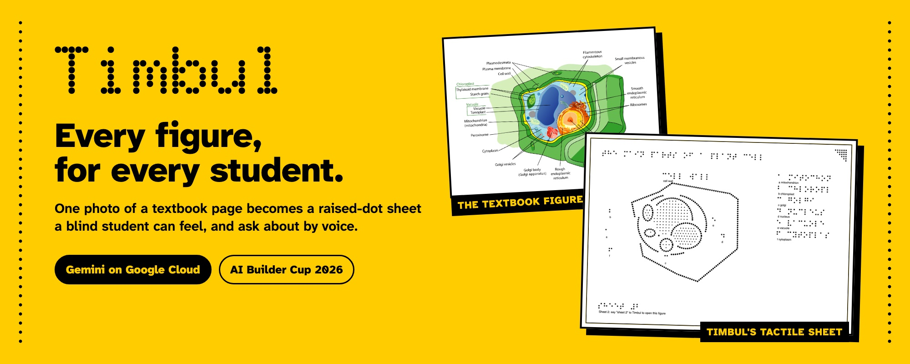
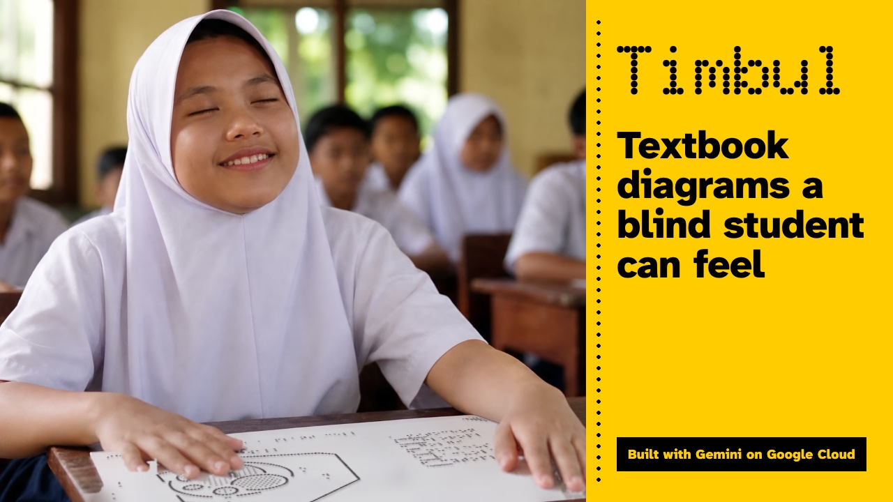
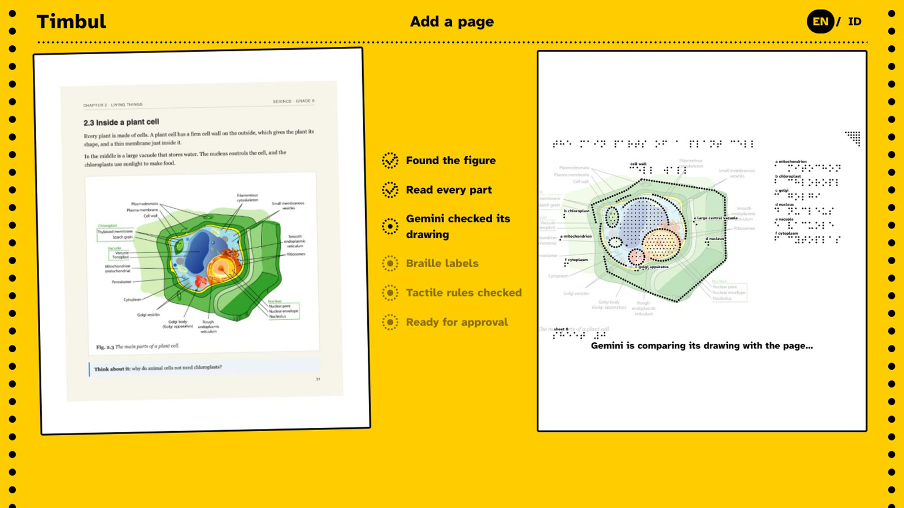
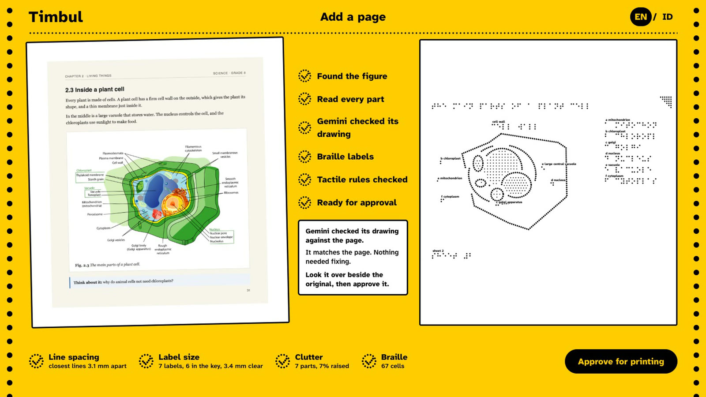
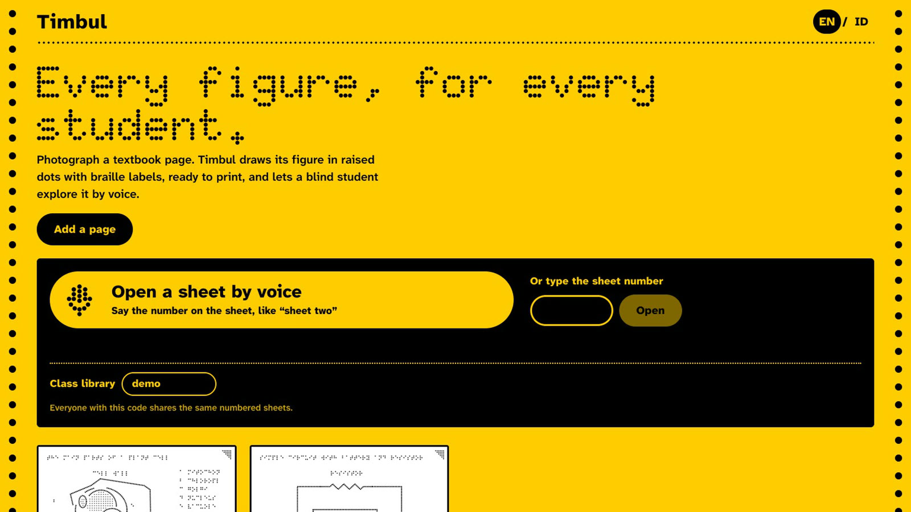
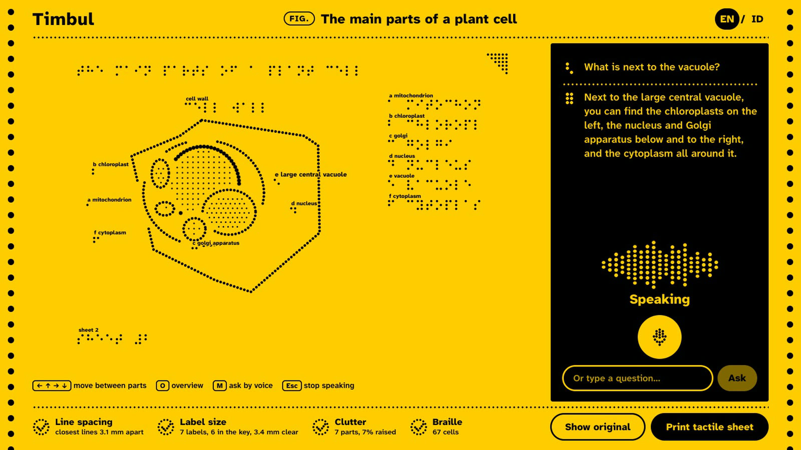
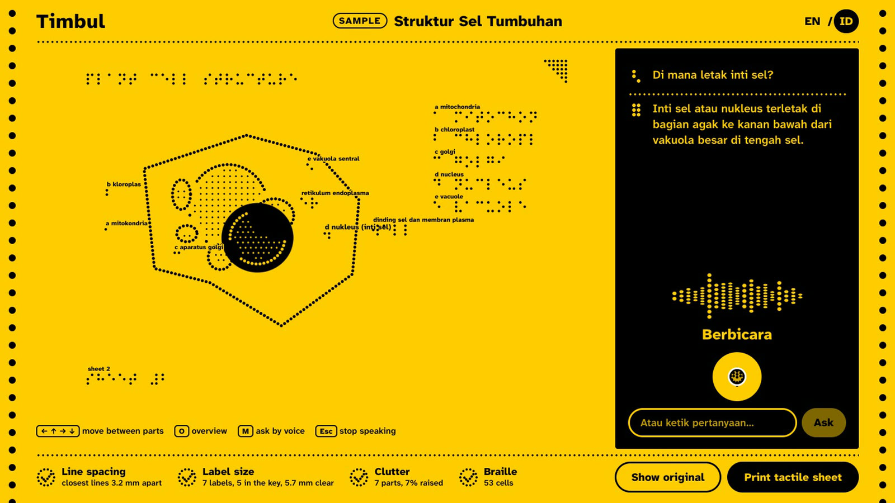
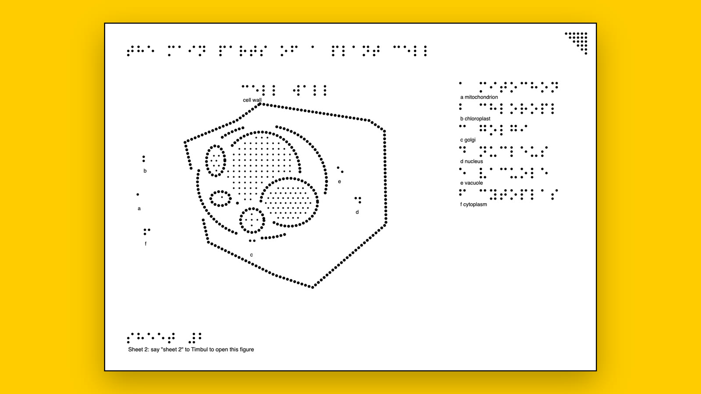

<div align="center">



# Timbul

[](https://timbul-aibc-2026.web.app)
[-c8281c?style=for-the-badge&logo=youtube&logoColor=white)](https://youtu.be/vN8Nwi9wOWY)
[](PRODUCT.md)
[](deck/work/Timbul%20-%20AI%20Builder%20Cup.pptx)
[](DEPLOYMENT.md)

[](https://aibuildercup.com)


<br />

<table align="center">
  <tr>
    <td align="center" valign="top" width="270">
      <a href="https://ai.google.dev"></a><br />
      <b>Gemini</b><br />
      <sub>The understanding. Finds the figure, reads every part, checks its own drawing against the page, finds the student's fingertip, hears the question and speaks the answer</sub>
    </td>
    <td align="center" valign="top" width="270">
      <a href="https://cloud.google.com"></a><br />
      <b>Google Cloud</b><br />
      <sub>The platform. Cloud Run serves the app and its API, Firestore holds the class library, Secret Manager keeps the keys</sub>
    </td>
    <td align="center" valign="top" width="270">
      <a href="https://firebase.google.com/products/hosting"></a><br />
      <b>Firebase Hosting</b><br />
      <sub>The front door. A short web address for teachers and students, forwarding to Cloud Run</sub>
    </td>
  </tr>
</table>


</div>

Timbul is for blind and low-vision students, and the teachers who make their materials.
A teacher photographs a textbook page. Gemini finds the figure, reads it, and checks its
own drawing against the page. Timbul's code draws a raised-dot sheet with braille labels,
ready to print on swell paper. The student feels the sheet, says its number, and explores
the same figure by voice, in English or Bahasa Indonesia.

*Timbul* is Bahasa Indonesia for "raised", and also "to emerge".

An entry for the [Google Cloud AI Builder Cup 2026](https://aibuildercup.com)
(Hack2skill × Google Cloud, JAPAC), by **team HammerLimbo Tech** (Padmanabhan Rajendrakumar
and Sharmila). Theme: **Sustainability & Social Impact**.

**Live demo:** https://timbul-aibc-2026.web.app (Firebase Hosting in front of Cloud Run, on Google Cloud).

**For the judges:** the submission text is in [SUBMISSION.md](SUBMISSION.md), the product
brief in [PRODUCT.md](PRODUCT.md) and the deck in [deck/work](deck/work/).

## The problem

The diagrams, graphs and maps in a textbook simply don't exist for a blind student. A
tactile version has to be drawn by hand, by a specialist, one figure at a time, so most
never reach the classroom.

| | | Source |
|---|---|---|
| **43.3 million** | people are blind worldwide | The Lancet Global Health, 2021 (VLEG, GBD 2020) |
| **12 million** | children and young people (0 to 19) in Southeast Asia live with vision loss | IAPB Vision Atlas (VLEG, GBD 2020) |
| **1 to 5 hours** | to draw one tactile figure by hand; a science textbook can hold 500 figures | Ladner et al., ASSETS 2005 |

## Watch it

<a href="https://youtu.be/vN8Nwi9wOWY"></a>

## How it works

**The teacher**

1. **Photographs a page.** Gemini finds the figure, Timbul crops to it, and Gemini reads the
   close-up: every part, where it sits and what it connects to, in English and Bahasa Indonesia.
2. **Gemini checks its own drawing.** Timbul draws the reading, lays it over a faded copy of
   the page and sends both back to Gemini, which corrects anything missing, misplaced or
   misnamed. Up to two rounds, with a time limit.
3. **Timbul's code draws the sheet.** Every line becomes raised dots at true size, with
   uncontracted braille labels and a key. Four tactile-graphics checks run on every sheet:
   lines at least 3 mm apart, braille clear of every line, at most 12 parts, every label in
   braille.
4. **Approves and prints.** Nothing prints until the teacher has compared the sheet with the
   original. The A4 SVG is in real millimetres, for swell paper or an embosser, with the sheet
   number in braille and an orientation notch.

| Gemini checks its drawing against the page | The checked sheet, ready to approve |
|---|---|
|  |  |

**The student**

5. **Opens the sheet by voice.** She says "sheet two" on the home screen. Approved sheets live
   in a class library, so a sheet made on the teacher's laptop opens on her own phone.
6. **Explores it.** Each part is spoken as she reaches it, by touch, arrow keys, or a swipe with
   VoiceOver or TalkBack. **O** gives an overview, **M** asks a question by voice, and the answer
   is spoken.
7. **Points and asks.** The phone's camera looks down at the printed sheet. She touches a raised
   shape and asks "what is this?". Gemini finds her fingertip and Timbul names the part.

| Open a sheet by voice | Explore, and ask | In Bahasa Indonesia |
|---|---|---|
|  |  |  |



## Real runs

Our own runs on 14 and 15 October 2026, with `scripts/check-reading.mjs` and
`scripts/check-point.mjs` in this repository. Nothing here is scripted.

| Measured | Result |
|---|---|
| Photo of a textbook page to a checked sheet | **about 30 s**: find the figure 1 to 2 s, read 10 to 26 s, self-check 10 to 35 s |
| Self-check on a part we moved on purpose (the nucleus) | **caught in 1 round** and put back; the second round confirmed the fix |
| Tactile-graphics checks, plant cell page | **4 of 4** passed (closest lines 3.1 mm against a 3 mm rule) |
| Tactile-graphics checks, neural-network diagram | **4 of 4** passed after grouping |
| Point and ask | **4 of 4** answered correctly: two parts, the same photo upside down, and no finger (7 to 21 s each) |

## The tech, part by part

**The model reads; our code draws.** Gemini does the understanding. Timbul's own code places
every dot and runs every rule check, so what the student hears always matches what they feel.

| Part | Built with | What it does |
|---|---|---|
| Find the figure, hear questions | **Gemini 3.5 Flash-Lite** | Locates the figure on the page; hears spoken questions and sheet numbers |
| Read the figure, check the drawing, find the fingertip | **Gemini 3.8 Flash** | Reads the close-up into structured JSON; compares its drawing with the page; aligns a phone photo with the sheet |
| Speak | **Gemini 3.8 Flash TTS** (voice Sulafat) | Every part name and answer, cached so each line is made once |
| Serve the app and API | **Cloud Run** | One container (`Dockerfile`, `server/index.mjs`), capped at one instance, scales to zero |
| Class library | **Firestore** | Numbered sheets shared by class code across devices |
| Keys | **Secret Manager** | The model keys, read by Cloud Run; never in code or the browser |
| Short address | **Firebase Hosting** | Forwards to Cloud Run |
| Tactile engine | **TypeScript** (`src/lib/tactile.ts`, `src/lib/braille.ts`) | Dots, occlusion, label placement, the four checks, A4 SVG export |
| App | **React, TypeScript, Vite** | Screen-reader labels, keyboard use, an offline copy in IndexedDB |

Each call falls back through further Gemini models when one is busy, with timeouts, and a
spending guard caps calls per visitor and per day. Every model is set by an environment
variable, so moving to a stronger model is a configuration change: the prototype runs on
Flash to stay within free allowances, and in real use figure reading and the self-check move
to **Gemini Pro**.

## Run it yourself

You need Node.js 20 or newer and a Gemini API key. Use Chrome for the voice features.

```bash
git clone https://github.com/padmanabhan-r/timbul.git
cd timbul
cp .env.example .env   # then add your keys
./start.sh             # installs on first run, app on http://localhost:5173
```

| Variable | For |
|---|---|
| `GEMINI_API_KEY` | Google's Gemini API: every model call |
| `OPENROUTER_API_KEY` | Optional backup route to the same Gemini models |
| `TIMBUL_READ_MODEL`, `TIMBUL_ASK_MODEL`, `TIMBUL_SPEAK_MODEL` | Optional: the model chain for each job, comma-separated, first choice first |
| `TIMBUL_CALLS_PER_HOUR`, `TIMBUL_CALLS_PER_DAY` | Optional: the spending guard (defaults 120 and 1,500) |

The keys stay on the server and are never sent to the browser. To put it on Google Cloud,
follow [DEPLOYMENT.md](DEPLOYMENT.md): Cloud Run, Firestore, Secret Manager and a $1 budget
alert, in about 45 minutes.

## Status and limits

Built and working end to end: find, read, self-check, the tactile sheet and its checks,
teacher approval, the class library, exploring by touch and voice, Point and ask, and both
languages.

- Busy scenes are the weak spot: the water cycle passes all four checks, but its landscape
  comes out as large boxy regions.
- Some key letters sit outside their part when no clear spot is inside it.

## Next steps

- **Stronger Gemini models.** Gemini Pro for reading and the self-check; Flash stays for
  quick questions and speech.
- **Point and ask on real sheets.** A phone stand and printed swell-paper sheets, then live
  video instead of a photo.
- **Test with real users.** Sessions with blind students and their teachers at special
  schools in Indonesia and India.
- **More languages and contracted braille.** Tamil, Thai and Vietnamese next.
- **Shared across schools.** A national library, so each textbook figure is made once for
  every school.

## Repository

| Path | What it is |
|---|---|
| `src/` | The app (React, TypeScript): screens, components, and the tactile engine in `src/lib/` |
| `server/` | The API (`api.mjs`), the Gemini calls (`gemini.mjs`), the class library (`library.mjs`) and the Cloud Run server (`index.mjs`) |
| `scripts/` | Pipeline checks: `check-reading.mjs <page.png>` runs find, read, draw and self-check on one image; `check-point.mjs <photo>` tests Point and ask |
| `api/` | A serverless wrapper of the same API, used for a test copy (not the judged deployment) |
| `deck/` | The pitch deck and the script that builds it |
| `docs/` | The hackathon brief and the next steps to submission |
| `Dockerfile` | The Cloud Run image |

```bash
node scripts/check-reading.mjs public/samples/plant-cell.png              # the full pipeline, overlays in .cache/check/
node scripts/check-reading.mjs public/samples/plant-cell.png --break <part-id>  # move a part of the last reading; the self-check should fix it
npm run build
```
